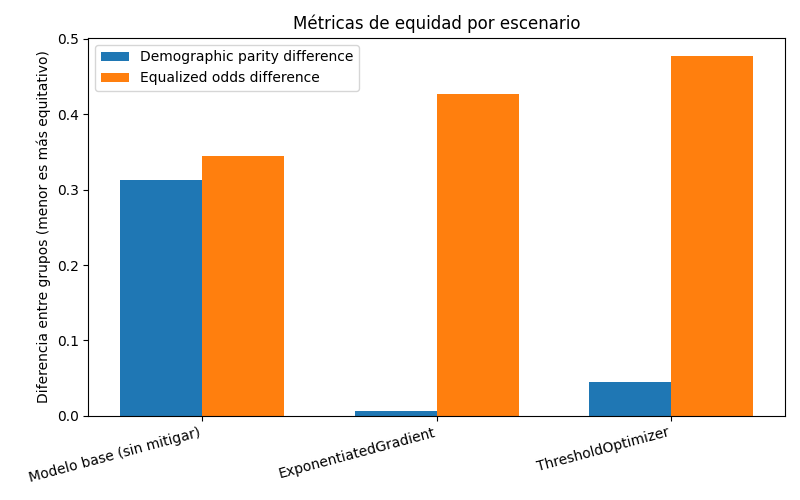
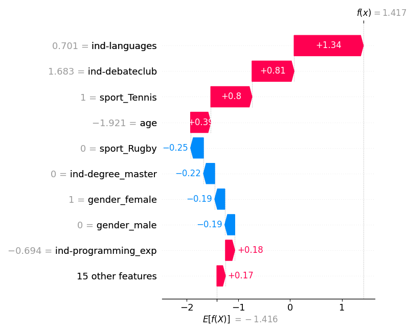
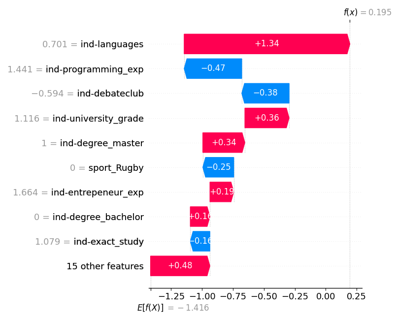
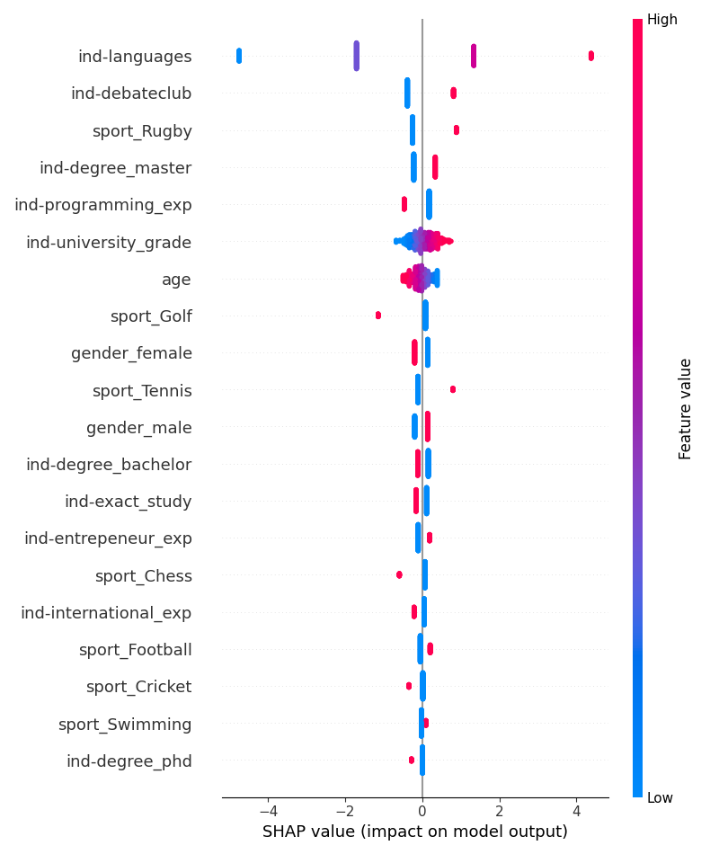
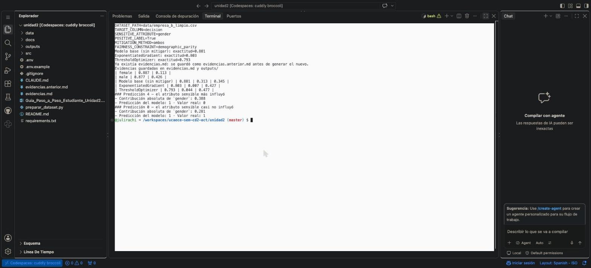

# Evidencias — Auditoría de equidad, mitigación y explicabilidad

**Alumno:** Julian Rachitzky · **Caso:** sistema de reclutamiento de Amazon (Dastin, 2018) · **Dataset:** Utrecht Fairness Recruitment dataset, empresa B (Burda & Van Otterloo, 2025)

_Generado automáticamente el 2026-10-18 15:26._

## Configuración de la corrida

- **Dataset:** data/empresa_b_limpio.csv
- **Columna objetivo:** `decision` (clase positiva: `True`)
- **Atributo sensible:** `gender`
- **Método de mitigación:** `ambos`
- **Restricción de equidad:** `demographic_parity`

## Auditoría de equidad — modelo base (pre-mitigación)

- **Exactitud global:** 0.881
- **Demographic parity difference:** 0.313
- **Equalized odds difference:** 0.345

### Métricas por grupo

| Grupo | Exactitud | Tasa de selección |
|---|---|---|
| female | 0.887 | 0.113 |
| male | 0.877 | 0.426 |

### Interpretación (consigna 8.d)

> El patrón es muy consistente con el caso de Amazon (Dastin, 2018). La exactitud es prácticamente igual para los dos grupos (0,887 en mujeres y 0,877 en hombres), así que si uno mirara solo esa métrica pensaría que el modelo funciona bien para todos. Pero la tasa de selección muestra otra cosa: el modelo recomienda contratar al 11,3% de las candidatas y al 42,6% de los candidatos, casi cuatro veces más. Eso da una demographic parity difference de 0,313.
>
> Lo que me parece más importante es que esa brecha no se explica por las calificaciones. En la empresa B las mujeres tienen en promedio mejor nota universitaria (64,2 contra 60,8) y el doble de experiencia en programación (44% contra 21%), pero en los datos históricos fueron contratadas en el 14,0% de los casos contra el 45,5% de los hombres. El modelo simplemente aprendió y reprodujo esa decisión histórica, que es exactamente lo que la unidad describe como sesgo histórico (Mehrabi et al., 2021) y lo que le pasó a Amazon al entrenar con diez años de CVs de una plantilla mayoritariamente masculina.
>
> La equalized odds difference (0,345) refuerza la idea: incluso entre las personas que sí fueron contratadas en los datos, el modelo identifica correctamente al 84,5% de los hombres pero solo al 50% de las mujeres (tasa de verdaderos positivos calculada aparte sobre el mismo modelo base). O sea que una candidata con el mismo resultado real tiene muchas menos chances de que el sistema la recomiende.

## Comparación antes / después de la mitigación

| Escenario | Exactitud | Demographic parity diff. | Equalized odds diff. |
|---|---|---|---|
| Modelo base (sin mitigar) | 0.881 | 0.313 | 0.345 |
| ExponentiatedGradient | 0.803 | 0.007 | 0.427 |
| ThresholdOptimizer | 0.793 | 0.044 | 0.477 |

### Interpretación (consigna 9.c)

> Respecto de la métrica que se le pidió optimizar (paridad demográfica), las dos técnicas fueron muy efectivas: ExponentiatedGradient bajó la demographic parity difference de 0,313 a 0,007 y ThresholdOptimizer a 0,044. Es decir que, después de mitigar, el modelo recomienda prácticamente la misma proporción de mujeres y de hombres.
>
> Pero esa mejora tuvo dos costos claros. Primero, la exactitud bajó de 0,881 a 0,803 y 0,793. Segundo, y me parece lo más interesante, la equalized odds difference empeoró (de 0,345 a 0,427 y 0,477). Igualar las tasas de selección sin mirar el resultado real hace que el modelo empiece a equivocarse de forma desigual: sube los aciertos y también los falsos positivos en las mujeres, y baja la tasa de verdaderos positivos en los hombres. Esto ilustra lo que plantea la unidad: no existe una única definición de equidad y distintas métricas pueden entrar en conflicto, por lo que elegir cuál priorizar es una decisión ética y no solo técnica (Verma & Rubin, 2018).
>
> Para comparar, hice una corrida complementaria con `FAIRNESS_CONSTRAINT=equalized_odds` (guardada en `outputs/corrida_equalized_odds/`):
>
> | Escenario | Exactitud | Demographic parity diff. | Equalized odds diff. |
> |---|---|---|---|
> | Modelo base (sin mitigar) | 0.881 | 0.313 | 0.345 |
> | ExponentiatedGradient | 0.858 | 0.201 | 0.054 |
> | ThresholdOptimizer | 0.861 | 0.186 | 0.076 |
>
> Con esa restricción pasa lo inverso: equalized odds cae a 0,054 con mucha menos pérdida de exactitud, pero queda una brecha de selección de alrededor de 0,19 a 0,20. Para un caso de contratación como el de Amazon creo que equalized odds es más defendible, porque busca que una candidata calificada tenga las mismas chances que un candidato calificado, en lugar de forzar cuotas iguales sobre etiquetas históricas que ya están sesgadas. Igual, ninguna de las dos corrige el problema de fondo, que es que la variable objetivo (la decisión histórica de contratar) está contaminada.
>
> Otras limitaciones que observé: las dos técnicas son aleatorizadas, así que las métricas mitigadas cambian un poco entre corridas (por ejemplo, ExponentiatedGradient dio entre 0,800 y 0,807 de exactitud en distintas ejecuciones), y ThresholdOptimizer necesita conocer el género de cada candidato al momento de predecir, lo que puede ser problemático legalmente. Además, el test tiene solo 295 casos (133 mujeres), por lo que las diferencias chicas no deberían sobreinterpretarse.

## Explicabilidad (SHAP) — modelo base

SHAP se aplica siempre sobre el modelo base, antes de cualquier mitigación: el objetivo es ver qué técnica de auditoría preventiva podría haber detectado el problema antes del despliegue (consigna 4).

### Predicción 4 — el atributo sensible más influyó

- Contribución absoluta de `gender`: 0.388
- Predicción del modelo: 1 · Valor real: 0

### Predicción 0 — el atributo sensible casi no influyó

- Contribución absoluta de `gender`: 0.281
- Predicción del modelo: 1 · Valor real: 1

### Resumen global

### Interpretación (consigna 10.b, vinculada a la consigna 4)

> Creo que sí: SHAP sobre el modelo base hubiera permitido detectar el problema antes de desplegarlo. En la predicción 4 (una candidata mujer) el género le resta 0,388 al log-odds de ser contratada (−0,19 por `gender_female` y −0,19 por `gender_male`), y en el resumen global se ve que esa penalización se aplica a todas las mujeres por igual, mientras que a los hombres el género les suma. Incluso la predicción elegida como "no discrimina" (la 0, un candidato varón) tiene una contribución del género de 0,281, es decir que en este modelo el género nunca deja de pesar: la diferencia entre ambos casos es solo de magnitud y de signo.
>
> El resumen global además muestra algo que me parece todavía más parecido al caso de Amazon: variables que en esta empresa están muy asociadas al género funcionan como proxies. La experiencia en programación, que tienen el 44% de las mujeres y el 21% de los hombres, tiene una contribución negativa (el modelo "castiga" un antecedente que debería ser positivo), igual que haber estudiado una carrera exacta. En cambio, el club de debate (35% de los hombres contra 13% de las mujeres), jugar al rugby (27% contra 8%) y la cantidad de idiomas suman. Es el mismo mecanismo de la palabra "women's" o de los verbos más comunes en CVs masculinos: aunque se sacara la columna de género, el sesgo seguiría entrando por estas variables.
>
> Por eso me parece que una auditoría preventiva tendría que combinar las dos cosas: métricas de equidad desagregadas (MetricFrame) para ver que hay una brecha, y SHAP (o LIME) para entender por qué existe y qué variables la producen (Lundberg & Lee, 2017).

## Captura de la ejecución final

## Referencias

- Burda, P., & Van Otterloo, S. (2025). Fairness definitions explained and illustrated with examples. *Computers and Society Research Journal*, 2025(2). https://doi.org/10.54822/PASR6281
- Dastin, J. (2018, 10 de octubre). Amazon scraps secret AI recruiting tool that showed bias against women. *Reuters*.
- Lundberg, S. M., & Lee, S. I. (2017). A unified approach to interpreting model predictions. *NeurIPS 30*.
- Mehrabi, N., Morstatter, F., Saxena, N., Lerman, K., & Galstyan, A. (2021). A survey on bias and fairness in machine learning. *ACM Computing Surveys, 54*(6), 1–35.
- Verma, S., & Rubin, J. (2018). Fairness definitions explained. *FairWare 2018*.

