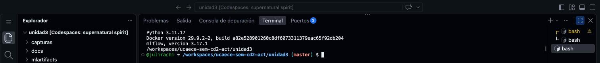
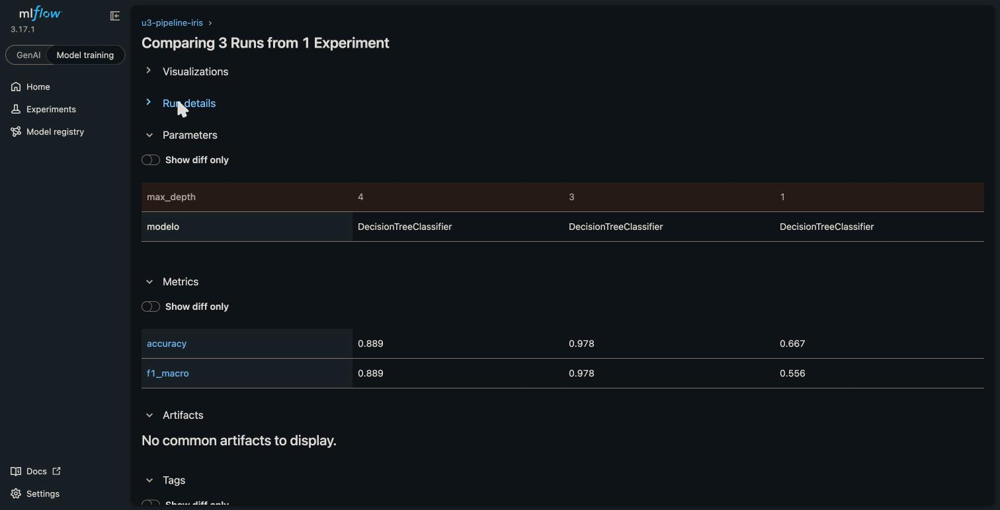
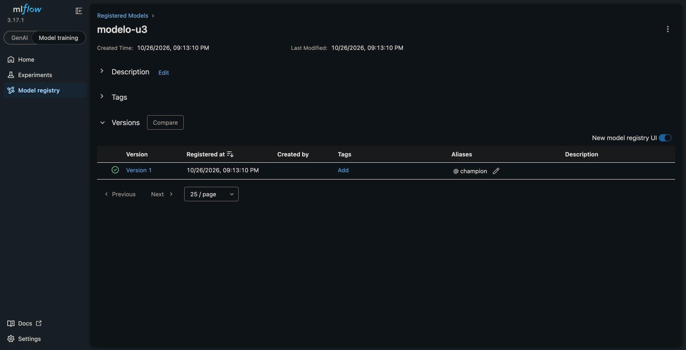
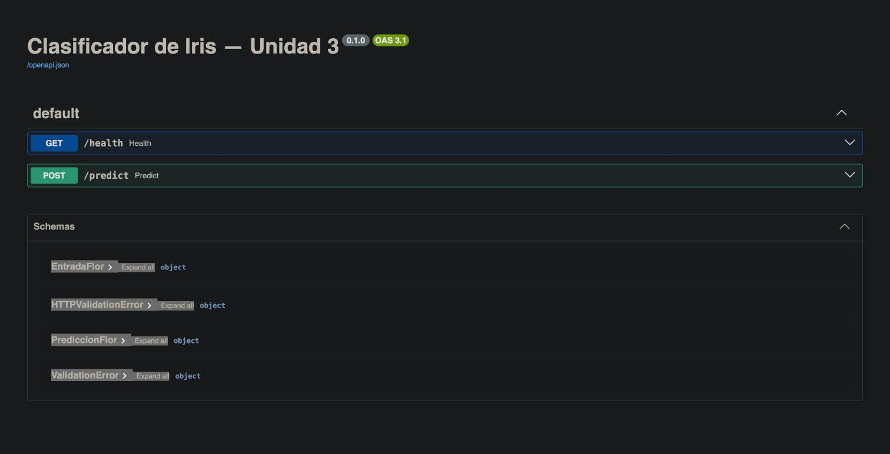
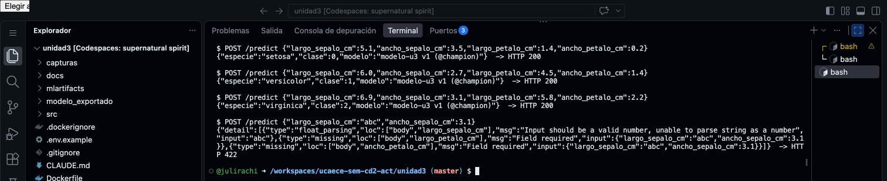
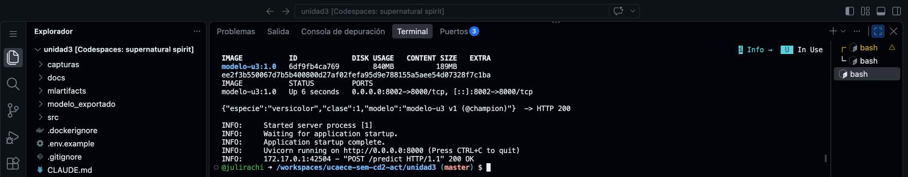

# Resultados — Unidad 3: MLOps/LLMOps

**Estudiante:** Julian Rachitzky
**Fecha:** 26/10/2026

---

## Consigna 6: Preparación del entorno

---

## Consigna 7: Experimentación y registro con MLflow

| Corrida | max_depth | accuracy | f1_macro |
|---------|-----------|----------|----------|
| arbol_max_depth_1 | 1 | 0.667 | 0.556 |
| arbol_max_depth_3 | 3 | 0.978 | 0.978 |
| arbol_max_depth_4 | 4 | 0.889 | 0.889 |

**Versión registrada:** modelo-u3 v1 (@champion), corrida con max_depth = 3

> Con max_depth=1 el árbol hace una sola pregunta y solo puede separar setosa del resto, por eso la accuracy queda en 0.667 y el f1 en 0.556. Con 3 llega a 0.978 y con 4 baja a 0.889: más profundidad no siempre generaliza mejor, se empieza a ajustar demasiado al train. Por eso conviene registrar todas las corridas, también las malas: queda documentado qué se probó y con qué resultado, se puede comparar contra la que está en producción y nadie repite una prueba que ya falló. Es lo mismo que pedí en la consigna 2 con MLflow para las versiones del prompt de CuotaYa.

---

## Consigna 8: Serving con FastAPI

| Entrada | Respuesta de la API |
|---------|---------------------|
| 5.1, 3.5, 1.4, 0.2 | setosa (clase 0), modelo-u3 v1 (@champion) |
| 6.0, 2.7, 4.5, 1.4 | versicolor (clase 1), modelo-u3 v1 (@champion) |
| 6.9, 3.1, 5.8, 2.2 | virginica (clase 2), modelo-u3 v1 (@champion) |
| largo_sepalo_cm = "abc", faltan dos campos | 422, con el detalle de cada campo inválido o faltante |

> Con el dato inválido la API devolvió un 422 antes de llegar al modelo: Pydantic valida el contrato (cuatro números mayores que cero) y responde qué campo falla y por qué. En producción esto importa porque la API recibe datos de otros sistemas y no puede confiar en que lleguen bien. Si el dato llegara al modelo, podría romper el servicio o, peor, devolver una predicción que parece válida. Así el error queda en el lado de quien mandó el dato y el modelo solo recibe entradas con el formato con el que se entrenó.

---

## Consigna 9: Containerización con Docker

> Cada imagen lleva su propio modelo adentro, así que modelo-u3:1.0 y modelo-u3:1.1 se pueden correr al mismo tiempo sin que una dependa de la otra. Para el canary que elegí en la consigna 3, se levanta un contenedor de 1.1 al lado de los de 1.0 y el balanceador le manda primero el 5% del tráfico, después el 25% y después el 100%. Si las métricas empeoran, se le saca el tráfico y queda solo 1.0, que nunca se tocó. El campo modelo de la respuesta permite saber qué versión contestó cada predicción.
